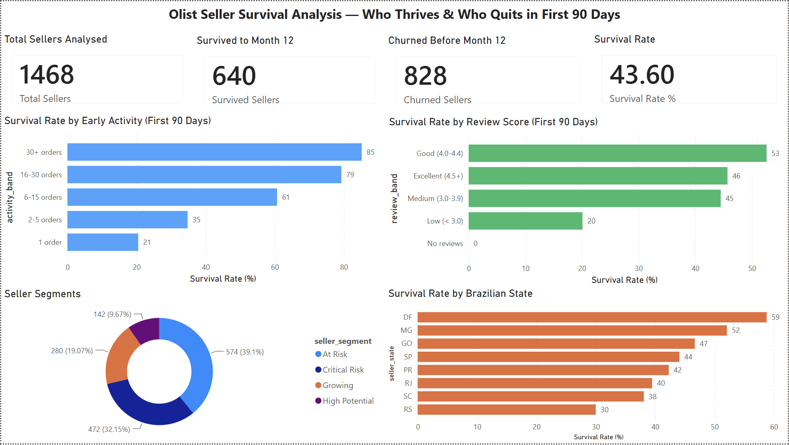
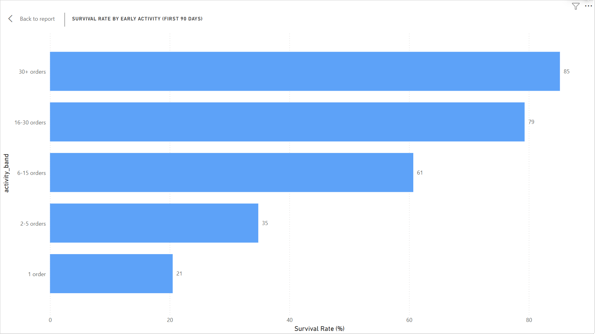
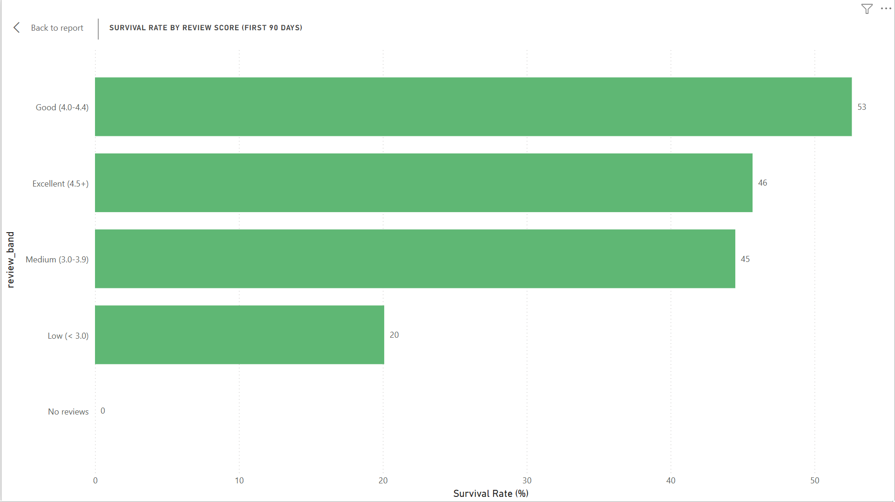

# 📦 Olist Seller Survival: Who Is Still Selling at Month 12?


> **Project 02** of my data analytics portfolio | 1,468 Olist sellers, first sale September 2016 to October 2017



> The review-score panel in this screenshot uses the original band edges, which leave a gap and put 57 sellers in the wrong band. The corrected review results are in [Finding 3](#headline-findings) and in `sql/06_data_checks.sql`.

---

## In 30 seconds

- **Question:** which behaviours in a seller's first 90 days predict whether they are still selling at month 12?
- **Answer:** early order volume. Sellers who make **6+ orders in their first 90 days survive at 68.7%, against 20.5% for sellers with one order (3.4 times)**. A review average below 3.0 is bad at every volume level, but from 4.0 upward reviews add little once volume is known.
- **Headline:** only **43.6%** of eligible sellers (640 of 1,468, 95% CI 41.1% to 46.1%) were still selling in months 10 to 12.
- **Output:** a 4-visual Power BI dashboard and a set of PostgreSQL scripts over a one-row-per-seller table.
- **Skills shown:** SQL (CTEs, CASE segmentation, stratified analysis, Wilson intervals written in SQL), Power BI, and checking my own results: several claims were corrected after testing (see [Corrections](#corrections-made-after-testing)).

---

## Business question
What behavioural signals in a seller's first 90 days predict whether they will still be active at month 12?

## Headline findings

| # | Finding | Evidence | Caveat |
|---|---|---|---|
| 1 | **Fewer than half of eligible sellers survive their first year.** | 640 of 1,468 sellers (43.6%, CI 41.1% to 46.1%) made at least one order in months 10 to 12. | Cohort of early sellers only (first sale on or before 2017-10-17). |
| 2 | **Early order volume is the strongest signal.** | Survival by orders in the first 90 days: 1 order **20.5%** (n = 361), 2 to 5 **34.8%** (574), 6 to 15 **60.7%** (331), 16 to 30 **79.3%** (121), 31+ **85.2%** (81). Six or more orders: **68.7%** (CI 64.6% to 72.5%, n = 533), 3.4 times the one-order rate. | Association, not proof that pushing a seller to more orders would keep them. |
| 3 | **A review average under 3.0 predicts churn at every volume level; from 4.0 upward, reviews add little once volume is held fixed.** | Under 3.0: **20.1%** survive (n = 199), the lowest group at 1, 2 to 5 and 6 to 15 orders (11.8%, 23.5%, 35.7%). Reviews of 4.0 to 4.49 and 4.5+ look alike at each volume: 21.9% vs 25.3%, 39.5% vs 39.7%, 64.6% vs 60.6%, 82.6% vs 81.8%. The 3.0 to 3.99 group trails at 2 to 5 orders (28.9%) but not at 6 or more (63.6%, 81.4%). | Averages come from few reviews for low-volume sellers. |
| 4 | **A perfect 5.0 average is a trap, not a health signal.** | 298 sellers average exactly 5.0 and **31.2%** of them survive (CI 26.2% to 36.7%). Their median is 1 early order, and 288 of the 298 made 5 or fewer. Sellers averaging 4.5 to 4.99 survive at 53.3%. | Perfect scores mostly signal "few reviews", not quality. |
| 5 | **Survivors look different from the start.** | Sellers who survived averaged 14.1 orders in their first 90 days and a 4.13 review average. Sellers who churned averaged 4.3 orders and 3.79. | Medians tell the same story: 7 early orders for survivors vs 2 for churned sellers. |
| 6 | **Survival rises steadily across the seller segments.** | High Potential **82.4%**, Growing **63.9%**, At Risk **34.8%**, Critical Risk **30.5%**. About 64% of sellers (935) made just 1 to 5 early orders. | **"Critical Risk" is not only one-order sellers**: see the segment table. |
| 7 | **Survival differs by state, but most state samples are small.** | SP (the largest, 875 sellers) 44.1%; MG 52.1% (n = 140, CI 43.9% to 60.2%); RS lowest at 30.0% (n = 50). Brasília (DF) shows 58.8% but on only **17 sellers** (CI 36.0% to 78.4%). | Only 8 states have 10+ sellers, so small states are not shown. |



## Seller segments
The segment rule in `sql/05` assigns each seller to the first rule they match:

| Segment | Rule as built | Sellers | Share | Survival |
|---|---|---|---|---|
| High Potential | 16+ orders and average review 4.0 or higher | 142 | 9.7% | 82.4% |
| Growing | 6 to 15 orders and average review 3.5 or higher | 280 | 19.1% | 63.9% |
| At Risk | 2 to 5 orders | 574 | 39.1% | 34.8% |
| Critical Risk | **Everything else:** 1 order, or 6+ orders with a weaker (or missing) review average | 472 | 32.2% | 30.5% |

Inside Critical Risk: 361 sellers made one order (20.5% survive) and 111 made 6 or more but did not meet the review threshold (43.1% survive at 6 to 15 orders, 80.0% at 16+). So "71% of sellers are At Risk or Critical Risk" overstates the problem; the cleaner statement is that **64% of sellers made only 1 to 5 orders** in their first 90 days. `sql/06` (check 6A) shows the breakdown.



## What "survival" means here
**Survived** = at least one order in months 10 to 12 after the seller's first sale. It is a binary 12-month retention flag measured at one point, not a time-to-event model, so there is no survival curve and no handling of censoring. Every seller in the analysis has had a full 12 months to be observed.

## Method
1. **Cohort:** sellers whose first sale was on or before **2017-10-17**, so each has a complete 12-month window (1,468 of 3,095 sellers; the other 1,627, about 53%, are excluded as too new to measure).
2. **Features from the first 90 days only:** number of orders, average review score, average order value. The outcome window (months 10 to 12) starts well after, so the predictors do not overlap the outcome.
3. **Exclusions:** cancelled and unavailable orders are removed from all calculations.
4. **Analysis:** survival rates by activity band, review band and state; segments by rule; stratified checks and confidence intervals in `sql/06`.
5. **Dashboard:** four visuals in Power BI Desktop built on the seller-level table from `sql/05`.

## SQL scripts
| Script | Purpose |
|---|---|
| `01` | Survived vs churned: seller counts and averages |
| `02` | Survival rate by early activity band |
| `03` | Survival rate by review band (original band edges) |
| `04` | Survival rate by state (states with 10+ sellers) |
| `05` | Seller-level table with segment and status for Power BI |
| `06` | Segment composition, review bands without gaps, survival by volume and review together, state intervals, and the exact volume contrast |

## Corrections made after testing
This README replaces an earlier write-up. Checking it against the seller-level data changed four claims:

| Earlier claim | What the data shows |
|---|---|
| "Sellers with 6+ orders are 3x more likely to survive (60.7% vs 20.5%)" | 60.7% is the 6 to 15 order band (3.0 times). For 6+ orders the rate is 68.7% (3.4 times). |
| "4.0 to 4.4 reviews outperform perfect 5.0 scorers (52.6% vs 45.7%)" | The original band edges left gaps, so 57 sellers were counted in the wrong band, and the "5.0" group was really everyone at 4.5+. Perfect 5.0 sellers survive at 31.2% and mostly have one early order. |
| "Brasília has the highest survival rate (58.8%)" | It rests on 17 sellers (CI 36.0% to 78.4%). Minas Gerais (52.1%, n = 140) is the best-supported strong state. |
| "Critical Risk = 1 order only (472)" and "71% At Risk or Critical Risk" | Critical Risk also contains 111 sellers with 6+ orders. About 64% of sellers made 1 to 5 orders. |

## Recommendations
Hypotheses to test, not proven causes.

1. **Treat the first 90 days as the onboarding window.** 361 sellers (25%) make a single order in that window and only 20.5% of them are still selling at month 12.
2. **Move 2 to 5 order sellers towards 6+.** They are the largest pool (574 sellers, 34.8% survival), and sellers at 6 or more orders survive at 68.7%. Test whether onboarding support actually shifts them.
3. **Target quality support at sellers with a review average under 3.0.** They are 199 sellers with 20.1% survival, and they do worse at every volume level.
4. **Do not read a perfect score as healthy.** Judge a seller's reviews together with how many orders they have.
5. **Weigh states by size.** São Paulo (875 sellers) is where a retention gain is worth the most sellers; Brasília's 58.8% is too small a sample to act on.

## Assumptions and limitations
- **One early cohort.** Sellers who joined after October 2017 are excluded, and the marketplace was growing, so later sellers may behave differently.
- **Binary outcome** measured in months 10 to 12; a seller who sold in month 9 and again in month 13 would count as churned.
- **Associations, not causes.** A seller with many early orders may simply be a bigger or more committed business.
- **Review averages** rest on few reviews for low-volume sellers (the perfect-5.0 group has a median of one early order), and 5 sellers have no reviews.
- **Dashboard review panel:** it uses the original band edges. The corrected numbers in this README come from `sql/06_data_checks.sql`.
- **Segment thresholds** are analyst-chosen, not tuned, and the segments overlap the activity bands by construction.
- **Dataset licence:** Kaggle lists the Olist dataset under CC BY-NC-SA 4.0 (non-commercial, share-alike). This is a non-commercial portfolio project; check the Kaggle page for current terms.

## Repository structure
```
02-olist-seller-survival/
├── data/        query result files (CSV)
├── images/      dashboard preview and chart screenshots
├── powerbi/     olist_seller_survival.pbix
├── sql/         01 to 06 PostgreSQL scripts (plus 00_build_seller_survival.sql)
└── README.md
```

## How to reproduce
1. Download the [Olist Brazilian E-Commerce dataset](https://www.kaggle.com/datasets/olistbr/brazilian-ecommerce) from Kaggle and load the order, order-item, review and seller tables into PostgreSQL.
2. Run `sql/00_build_seller_survival.sql` to create the one-row-per-seller table `seller_survival` (definitions are in [Method](#method)). It should contain 1,468 rows, of which 640 have `survived_month_12 = 1`.
3. Run `sql/01` to `sql/06` one query at a time (highlight, F5) and compare with the files in `data/`.
4. Open `powerbi/olist_seller_survival.pbix` in Power BI Desktop and point it at the output of `sql/05`.

## Data source
[Brazilian E-Commerce Public Dataset by Olist](https://www.kaggle.com/datasets/olistbr/brazilian-ecommerce) (Kaggle), covering about 100,000 orders from September 2016 to October 2018 across 3,095 sellers.

## More from my portfolio
- **Project 01**: [NHS Readmission Risk Analysis](https://github.com/gunasundarram/01-nhs-readmission-risk) (SQL, Excel, Tableau)
- **Project 03**: [The Attrition Blindspot](https://github.com/gunasundarram/03-hr-attrition-blindspot) (SQL, Power BI, Python)
